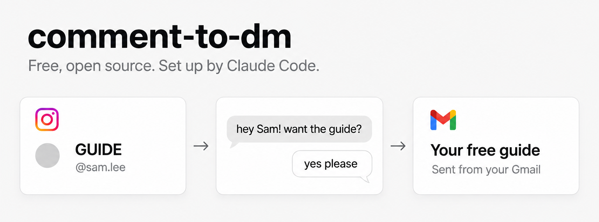

# comment-to-dm

A free bot that answers the people who comment on your Instagram reels.

## What it does

You post a reel and tell people to comment a keyword if they want something from you, like a guide, a template or a list. When someone comments, the bot sends them a friendly DM a minute or so later, while they are still on your reel. If they want the material, the bot asks for their email, saves it, and sends the material from your own Gmail a couple of minutes later.

It sounds like you, not like a bot. Replies come from a bank of messages you have approved, and a cheap AI writes one only when nothing fits. If a comment is off topic, upset or unclear, the bot leaves it alone and puts it on your dashboard with a note on what to do.

The flow looks like this.

- Someone comments your keyword on a reel.
- The bot sends a DM and a short public reply.
- They say yes, and the bot asks for their email.
- They send it, and your material arrives in their inbox from your Gmail.

It uses only Instagram's official API, so your account is not at risk from unofficial tools. It runs on your Mac, or on a small cloud server if you want it on all day.

## What it costs you

The code is free, and so is the licence. There is no monthly subscription to Make.com, ManyChat or anything like it.

You pay small usage fees to the AI provider you choose, and only for the replies the AI writes. Most replies come from your approved messages and cost nothing. Your dashboard shows what you have spent.

On a Mac, a cloud server is optional. If you want the bot running when your Mac is off, expect to pay a few dollars a month to a hosting company. Running it on your own Mac costs nothing extra. On Windows, the bot always runs on a cloud server, so expect that monthly cost from the start.

You also need Claude Code, which has its own plan. Check the current plans on the Claude Code page.

## Before you start

You need an Instagram Professional account, which is a Creator or Business account. If yours is a personal account, Claude helps you switch, and it is free.

You also need a Facebook account and a Gmail account.

On Windows, the bot runs on a small cloud server (a few dollars a month). Claude sets it up for you.

## How to start

1. If you are on Windows, install Git for Windows from https://git-scm.com/downloads/win first. Then install Claude Code from https://claude.com/claude-code.
2. Open the window where you type commands.
   - On a Mac, press Command and Space, type Terminal, and press Enter.
   - On Windows, open the Start menu, type Git Bash, and press Enter. Type every command below in Git Bash.
3. Download this project by typing `git clone https://github.com/woodhk/comment-to-dm.git` and pressing Enter. On a Mac, the first time you use git, it asks to install some tools, so click Install. Wait until it says it's finished, and then type the same `git clone` line again.
4. Type `cd comment-to-dm` and press Enter. Then type `claude` and press Enter. On Windows, if it says `claude` isn't found, close Git Bash, open it again and try once more.
5. Claude Code asks whether you trust the files in this folder. Choose Yes.
6. Type `set me up`.

You can also download the project with the "Download ZIP" button on GitHub. Claude then helps you swap it for a git copy, because updates need git.

Claude takes it from there. It asks you a few questions, opens the pages you need, and does the technical parts for you. You stay in charge of anything that involves your accounts, your passwords or your card.

## Updating

When there is a new version, tell Claude `update my bot`. Claude works out where your bot runs and updates it there. On a Mac whose bot runs on the Mac, you can also run `bash scripts/update.sh` yourself. On Windows, always ask Claude, because your bot runs on your server and the update happens there. Your settings, keys and leads stay where they are.

## Made by Alex Wood

I built this bot for my own reels and shared it with you. You can find me on Instagram at [@alexwood.j](https://www.instagram.com/alexwood.j/).

## If this saved you time

If the bot saved you time, you can buy me a coffee at https://buymeacoffee.com/alexwoodyai. It is never required, and the bot works just the same without it.
